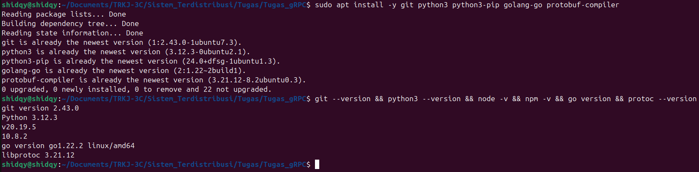
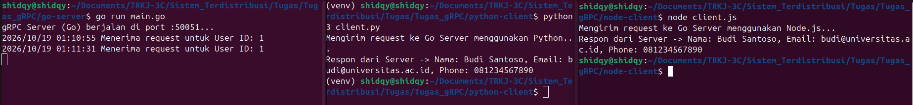

# Hands-on: Komunikasi Inter-service dengan gRPC (Polyglot)

Repository ini berisi implementasi komunikasi antar-layanan (inter-service) menggunakan framework gRPC pada OS Linux Ubuntu. Proyek ini mendemonstrasikan arsitektur Polyglot di mana Server dibuat menggunakan Go (Golang), sedangkan Client diimplementasikan menggunakan Python dan Node.js berbasis satu kontrak Protocol Buffers (`user.proto`). Pada proyek ini juga ditambahkan properti `string phone = 3;` sebagai bagian dari tugas evaluasi mandiri.

## Struktur File

* `user.proto`: Kontrak antarmuka (Interface Definition Language) yang digunakan oleh seluruh service.
```protobuf
syntax = "proto3";

package user;

option go_package = "./pb";

message UserRequest {
  int32 user_id = 1;
}

message UserResponse {
  string name = 1;
  string email = 2;
  string phone = 3; // Modifikasi Tugas Evaluasi Mandiri
}

service UserService {
  rpc GetUserProfile (UserRequest) returns (UserResponse);
}
```
* `main.go`: Implementasi gRPC Server menggunakan bahasa Go yang berjalan pada port 50051.
```go
package main

import (
	"context"
	"log"
	"net"

	pb "go-server/pb" // Sesuaikan dengan nama module Anda
	"google.golang.org/grpc"
)

type server struct {
	pb.UnimplementedUserServiceServer
}

func (s *server) GetUserProfile(ctx context.Context, req *pb.UserRequest) (*pb.UserResponse, error) {
	log.Printf("Menerima request untuk User ID: %d", req.GetUserId())
	
	// Response data disesuaikan dengan evaluasi mandiri (menambahkan phone)
	return &pb.UserResponse{
		Name:  "Budi Santoso",
		Email: "budi@universitas.ac.id",
		Phone: "081234567890",
	}, nil
}

func main() {
	lis, err := net.Listen("tcp", ":50051")
	if err != nil {
		log.Fatalf("Gagal listen: %v", err)
	}
	s := grpc.NewServer()
	pb.RegisterUserServiceServer(s, &server{})
	log.Println("gRPC Server (Go) berjalan di port :50051")
	if err := s.Serve(lis); err != nil {
		log.Fatalf("Gagal serve: %v", err)
	}
}
```
* `client.py`: Implementasi gRPC Client menggunakan bahasa Python.
```python
import grpc
import user_pb2
import user_pb2_grpc

def run():
    with grpc.insecure_channel('localhost:50051') as channel:
        stub = user_pb2_grpc.UserServiceStub(channel)
        print("Mengirim request ke Go Server menggunakan Python...")
        
        # Mengirim request dengan user_id = 1
        response = stub.GetUserProfile(user_pb2.UserRequest(user_id=1))
        
        print(f"Respon dari Server -> Nama: {response.name}, Email: {response.email}, Phone: {response.phone}")

if __name__ == '__main__':
    run()
```
* `client.js`: Implementasi gRPC Client menggunakan Node.js dengan pendekatan Dynamic Runtime Generation.
```javascript
const grpc = require('@grpc/grpc-js');
const protoLoader = require('@grpc/proto-loader');
const path = require('path');

const PROTO_PATH = path.resolve(__dirname, '../user.proto');
const packageDefinition = protoLoader.loadSync(PROTO_PATH, {
    keepCase: true,
    longs: String,
    enums: String,
    defaults: true,
    oneofs: true
});
const userProto = grpc.loadPackageDefinition(packageDefinition).user;

function main() {
    const client = new userProto.UserService('localhost:50051', grpc.credentials.createInsecure());
    console.log("Mengirim request ke Go Server menggunakan Node.js...");
    
    client.GetUserProfile({ user_id: 1 }, (error, response) => {
        if (!error) {
            console.log(`Respon dari Server -> Nama: ${response.name}, Email: ${response.email}, Phone: ${response.phone}`);
        } else {
            console.error(error);
        }
    });
}

main();
```

### Panduan Pengujian

1. Verifikasi Lingkungan (Environment Setup)

   1. Buka terminal dan pastikan seluruh tools yang dibutuhkan (git, python3, node, go, protobuf-compiler) telah terinstal pada sistem operasi Linux (Ubuntu). Jalankan perintah verifikasi versi.

```bash
* sudo apt install -y git python3 python3-pip golang-go protobuf-compiler
# Verifikasi Status
* git --version && python3 --version && node -v && npm -v && go version && protoc --version
```


2. Menjalankan gRPC Server (Go)

   1. Buka terminal, masuk ke direktori go-server. Lakukan instalasi dependensi, kompilasi protobuf, dan jalankan server.

```bash
# Install dependency dan plugin
* go get google.golang.org/grpc
* go install google.golang.org/protobuf/cmd/protoc-gen-go@latest
* go install google.golang.org/grpc/cmd/protoc-gen-go-grpc@latest

# Generate protobuf
* protoc --proto_path=../ --go_out=. --go-grpc_out=. ../user.proto

# Jalankan server
* go run main.go
```
.png)

3. Menjalankan gRPC Client (Python)

   1. Buka terminal baru, masuk ke direktori python-client. Instal library yang dibutuhkan, generate file Python dari .proto, lalu jalankan client.

```bash
# Install library
* pip3 install grpcio grpcio-tools

# Generate file python
* python3 -m grpc_tools.protoc --proto_path=../ --python_out=. --grpc_python_out=. ../user.proto

# Jalankan client
* python3 client.py
```

.png)

4. Menjalankan gRPC Client (Node.js)

   1. Buka terminal baru, masuk ke direktori node-client. Inisialisasi npm, install paket gRPC, lalu jalankan script Node.js.

```bash
# Inisialisasi dan install
* npm init -y
* npm install @grpc/grpc-js @grpc/proto-loader

# Jalankan client
* node client.js
```
.png)

5. Pengujian Bersamaan (3 Terminal Berdampingan)

   1.Jalankan Server Go, Client Python, dan Client Node.js secara bersamaan di terminal yang berbeda. Kedua client akan berhasil menerima respon data yang sama dari server Go (termasuk field phone).



### Analisis Pendekatan Kompilasi Protobuf (Static vs Dynamic)
Dalam praktikum ini, terdapat dua pendekatan berbeda dalam memproses berkas skema .proto:

1. Static Code Generation (Digunakan pada Go & Python):
Pendekatan ini menggunakan compiler protoc untuk menghasilkan kode sumber native (.go dan _pb2.py) sebelum aplikasi dijalankan (build time). Keunggulannya adalah tersedianya type-checking yang ketat, autocomplete pada IDE, serta pemrosesan awal yang lebih cepat saat runtime karena tidak ada overhead parsing file skema secara berulang.

2. Dynamic Runtime Generation (Digunakan pada Node.js):
Pendekatan ini memanfaatkan pustaka @grpc/proto-loader untuk membaca dan melakukan parsing berkas user.proto secara langsung saat aplikasi baru dijalankan (runtime). Keunggulannya adalah fleksibilitas tinggi dan alur pengembangan yang lebih ringkas tanpa perlu mengeksekusi langkah kompilasi manual setiap kali ada perubahan skema, meskipun mengorbankan sedikit overhead pemrosesan saat aplikasi startup.
